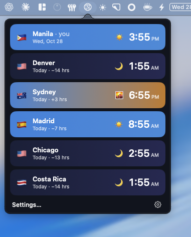
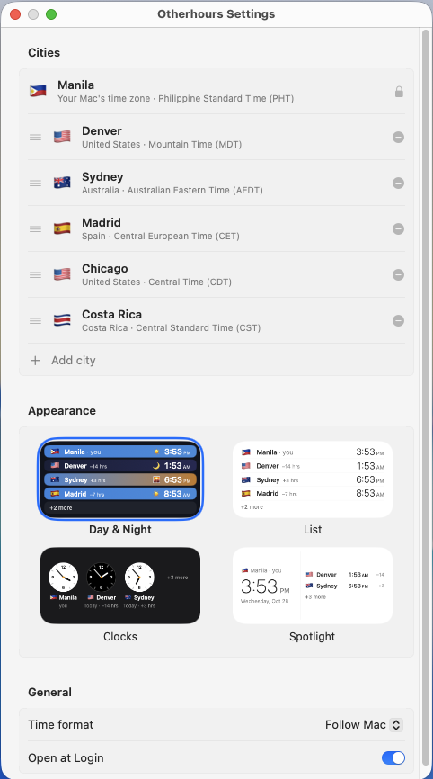
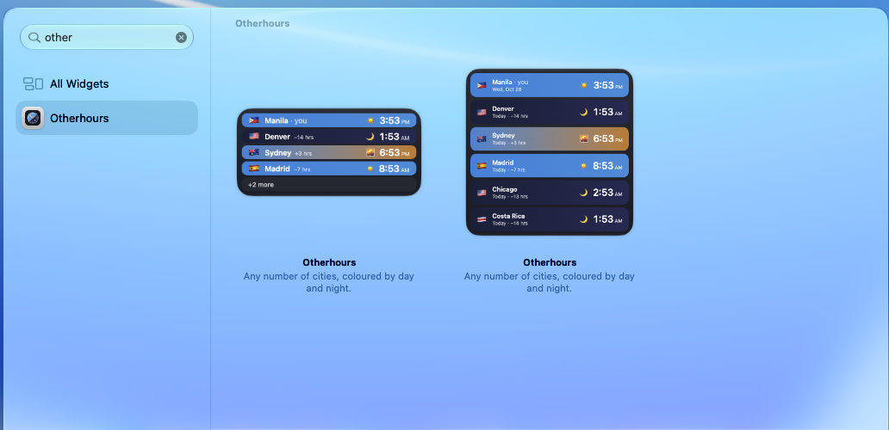
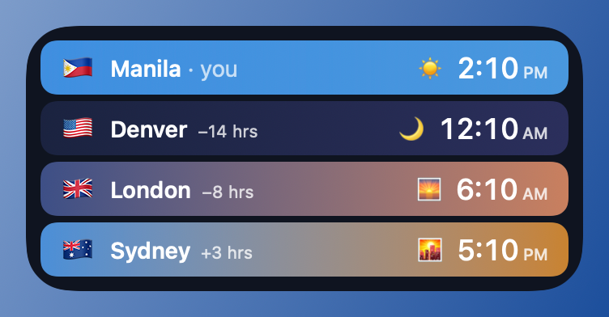
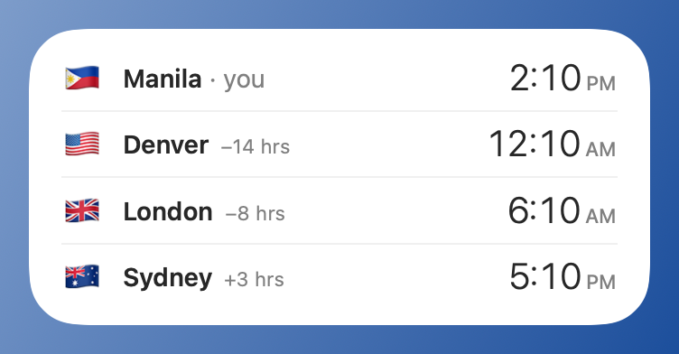
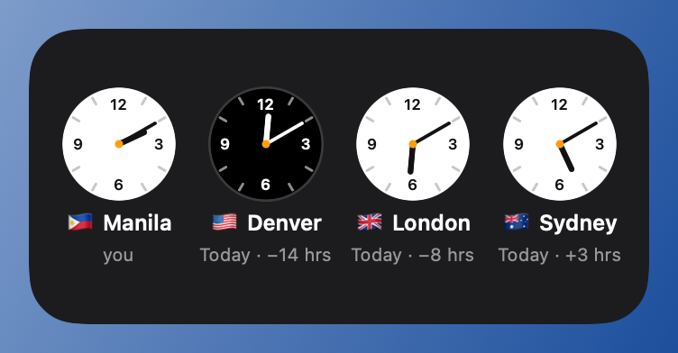
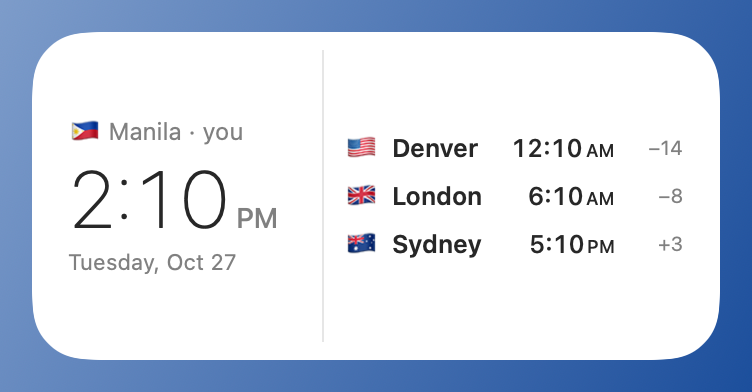

# Otherhours

**The hours over there.** A free, open-source macOS desktop widget and menu bar app that shows your own time plus as many cities as you want. Each city gets its flag and a row coloured by its sky right now (night, dawn, day, dusk), so you can see at a glance who is asleep.

Apple's World Clock widget stops at four cities and shows clock faces only. I wanted any number of cities, at a glance, on one widget.

<p align="center">
  
  &nbsp;
  
</p>



## What it does

- **Any number of cities**, set in one place: click the globe clock in the menu bar, then **Settings…**.
- **Search that knows what you mean.** Type a city ("syd" offers Sydney, Australia and Sydney, Canada), a state ("Colorado" gives Denver, Mountain Time), a country ("Japan" gives Tokyo; "United States" gives its 7 clocks), an abbreviation ("PST", "AEST", "IST") or a zone name ("Mountain Time"). Each suggestion shows its local time, so you can tell you picked the right clock. Arizona correctly gives Phoenix, which skips daylight saving.
- **Your own time comes first**, from the Mac's clock. Install it in New York and it shows New York; travel, and it follows the Mac within seconds.
- **Four themes**, for the widget and the panel alike:

| Day & Night | List | Clocks | Spotlight |
|---|---|---|---|
|  |  |  |  |

  List and Spotlight follow the Mac's light or dark mode.
- **Medium and large widgets.** Long lists turn compact, then end in "+N more".
- **Menu bar panel** with the same rows, every city shown.
- **Daylight saving is automatic.** Times, day words ("Tomorrow · +3 hrs") and colours update every minute.
- 12- or 24-hour time, following the Mac or set by hand.

## How it's built (and why it's unusual)

Widgets normally need Xcode. This one is a Swift package built with `swift build`, assembled and signed by a script:

- **The extension's entry point.** `Package.swift` links the widget with `-e _NSExtensionMain`. Without it the extension starts at Swift `main`, never handshakes with macOS, and the widget gallery shows nothing.
- **Settings without an App Group.** Sharing data between an app and its widget normally needs an App Group, which needs a paid developer account. Here the widget is ad-hoc signed with the app sandbox plus a read-only exception for the app's own preferences (`com.apple.security.temporary-exception.shared-preference.read-only`). The app saves; the widget reads; the app asks WidgetKit to reload.
- **The search** (`Sources/WorldClockCore/PlaceSearch.swift`) indexes 34,000 GeoNames cities, their states and provinces, country names and a hand-made abbreviation table. Time zones are grouped into real clocks: two zones are one clock when they agree now and at every change over the next 12 months, so America/Detroit folds into New York while Phoenix stays apart from Denver.
- **Tested logic, rendered views.** Rules live in `WorldClockCore` with Swift Testing tests (search, clock grouping, labels, layout caps, stored settings). Views live in `WorldClockViews`; `WorldClockPreview` renders them to PNG, which is how the images above were made.

Design and evidence: `docs/specs/2026-10-27-world-clock-design.md` (the widget) and `docs/specs/2026-10-27-settings-design.md` (settings, search, themes).

## Install

**Requirements:** macOS 14 or later, Apple silicon or Intel (universal). Built and tested on macOS 27; earlier versions are untested.

1. Download `Otherhours-x.y.z.zip` from [Releases](../../releases) and unzip it.
2. Drag **Otherhours.app** into **Applications**.
3. Open it. macOS says it "could not verify" the app, because it is not notarized (notarizing needs a paid Apple Developer account). Click **Done**, then open **System Settings › Privacy & Security**, scroll down and click **Open Anyway** next to Otherhours.
   - Or, in Terminal: `xattr -dr com.apple.quarantine /Applications/Otherhours.app`
4. A globe with clock hands appears in the menu bar. Click it, then **Settings…**, and add cities.
5. Right-click the desktop › **Edit Widgets**, search **Otherhours**, and add the medium or large size.

The app starts at login (switch it off in the menu bar's gear menu or in System Settings › General › Login Items). It has no Dock icon. **If the widget ever turns grey,** open Otherhours again: each launch re-registers and reloads the widget.

### Build from source

Needs only the Xcode Command Line Tools (`xcode-select --install`), no Xcode.

```sh
scripts/build.sh          # build, sign ad-hoc, install to ~/Applications, open
scripts/package.sh        # build the release zip in build/
```

`build.sh` builds a universal app, checks the extension's entry point and entitlements, signs ad-hoc, installs to your `~/Applications` (set `INSTALL_DIR` to change it), registers the widget and opens the app.

## Develop

- Tests: `scripts/test.sh` (Swift Testing, WorldClockCore). The macOS 26.5 SDK is pinned in the scripts because the newer SDK needs full Xcode for SwiftUI macros; change `SDKROOT` if yours differs.
- Previews: `swift run -c release WorldClockPreview Resources/cities.tsv docs/previews`.
- Data: `python3 -I scripts/make_cities.py` regenerates `Resources/cities.tsv` and `Resources/regions.tsv` from GeoNames. `Resources/abbreviations.tsv` is hand-made.
- Logs: `/usr/bin/log show --last 5m --info --predicate 'subsystem == "com.jasonaldemita.otherhours"'` (each widget timeline logs its city count). Use the full path: zsh has its own `log` command.
- Manual checks: `docs/manual-checklist.md`.
- Naming: the app was called World Clock until 2026-10-28. The Swift targets and the repo folder keep that name; the app, widget, bundle IDs and preferences are Otherhours, and the first launch copies settings from the old `com.jasonaldemita.worldclock` preferences.

## How it was made

I designed Otherhours and tested it on my own Mac; the code was written with [Claude Code](https://claude.com/claude-code). The design notes and build plans are in `docs/`.

## Support

Otherhours is free. If it's useful to you, you can [buy me a coffee](https://ko-fi.com/jayzor7489). Bug reports and ideas are welcome in [Issues](../../issues).

## Credits

City, region and country data from GeoNames (geonames.org), CC BY 4.0.

## License

MIT. See [LICENSE](LICENSE).
